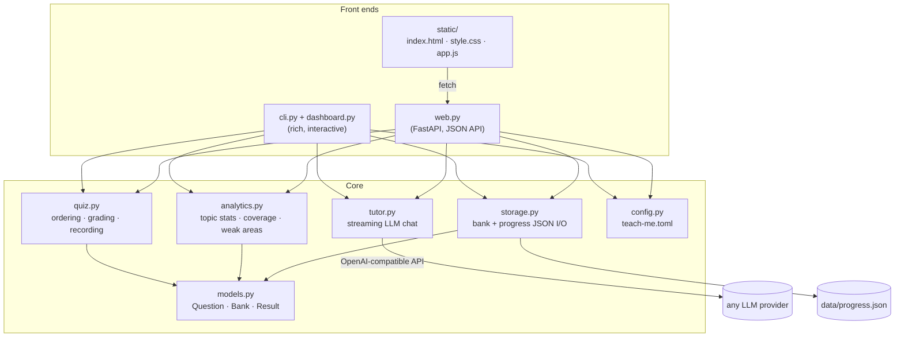

# Architecture

Two thin front ends — a terminal UI and a web UI — over one shared core. The
core modules are pure: they take a `Bank` and a `Progress`, return data, and
report expected failures as `Ok`/`Err` results rather than exceptions.

## The web layer

`web.py` exposes the CLI's flows one-to-one:

| Endpoint | CLI equivalent |
| --- | --- |
| `GET /api/chapters` | the chapter picker shown at startup |
| `GET /api/state` | the main menu header (subject, sets, topics, tutor availability) |
| `POST /api/quiz` | `pick_questions` — modes `all`, `topic`, `weak`, `unseen`, `missed` |
| `POST /api/answer` | answer parsing, grading, `record_result`, save |
| `POST /api/session` | `record_session` on quiz end / return to menu |
| `GET /api/dashboard` | the progress dashboard |
| `POST /api/tutor` | the tutor chat (streamed as plain text) |

Design decisions:

- **Answers stay server-side.** `POST /api/quiz` strips `correct` and
  `explanation`; they only come back from `POST /api/answer` after the student
  commits. `select_n` is included for multi-answer questions because the CLI
  also tells you how many to pick.
- **Grading reuses `quiz.parse_answer`.** The browser sends the chosen letters
  as a string, so validation and error messages match the terminal exactly.
- **The tutor is stateless per request.** The browser keeps the chat history
  and sends it with each turn; the server rebuilds the system prompt (question
  context, hint vs. reveal stage, progress summary) and streams the reply.
- **One `Progress` per chapter in memory, one lock.** Each chapter's bank and
  progress are loaded at startup; requests name the chapter by slug (omitted =
  first chapter). Mutations happen under a `threading.Lock` and persist after
  every answer, mirroring the CLI's save-after-every-answer behaviour. There is
  no authentication: everyone who can reach the server shares the progress
  files.

The front end (`teach_me/static/`) is a single page of hand-written HTML, CSS
and vanilla JS — no build step. `app.js` is a small state machine over the
views (menu, topic picker, quiz, session summary, dashboard, tutor) and mirrors
the CLI's keyboard shortcuts.
